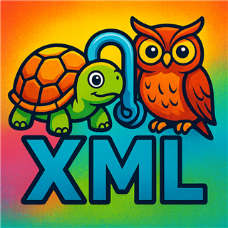

<p align="center">
  
</p>

<h1 align="center">The tarka Manual</h1>

<p align="center">
  <em>From tables to triples along the Bookshop Trail:<br/>
  TARQL queries, OTTR templates and data frames, and how to know the RDF is right.</em>
</p>

---

## What this is

**tarka** turns tables into RDF. A CSV file, a Parquet or Arrow file, or a Polars data frame
goes in; a knowledge graph comes out, shaped by a mapping you write in one of three languages:
a **TARQL** query, a set of **OTTR** templates, or a **bOTTR** mapping file. It runs as a
command, `tarka`, and as a Python package, `tarka-rdf`, and it is built on
[HOLOS](https://github.com/pwin/triplestore), whose SPARQL engine evaluates every query.

This manual teaches all of it, from a first five-line mapping to a pipeline that checks its
own output, on one dataset throughout: **the Bookshop Trail**, a fictional network of
independent bookshops at real British places. It is the dataset of the Semantechs
[SPARQL](https://www.semantechs.co.uk/SPARQL_Course/),
[SHACL](https://www.semantechs.co.uk/SHACL_Course/) and
[Ontology](https://www.semantechs.co.uk/Ontology_Course/) courses, with its ontology. The trail
committee keeps its records in spreadsheets; by the end of the manual, those spreadsheets have
become the courses' graph, triple for triple, and you have proved it.

The name is a nod to Henry Williamson's *Tarka the Otter*, who lived in "the country of the two
rivers". tarka lives where two ways of making RDF meet: TARQL, and OTTR, which is said "otter".

## Who it is for

- **Data engineers** with tables to publish as a knowledge graph, who know SQL and Python and
  have met RDF.
- **Ontologists and modellers** who own the vocabulary and want to see it filled, and checked,
  the way they meant it.
- **Anyone running a semantic practice**: the manual connects to the
  [SemOps Manual](https://www.semantechs.co.uk/SemOps_Manual/), whose Chapter 10 puts tarka in
  the ingest stage of a pipeline, and to the Ontology Quality Suite that assesses what it
  produces.

You need to read a little SPARQL and Turtle. Nothing else is assumed; OTTR is taught from the
start.

## How to read it

Part I sets out: what tarka does, how to install it, and the trail. Then take the parts in
order, or go straight to the one you need:

| Part | Read it to | Chapters |
|---|---|---|
| I. Setting out | know what tarka does, install it, and meet the trail and its spreadsheets | [1](docs/01-what-tarka-does.md), [2](docs/02-installing.md), [3](docs/03-the-bookshop-trail.md) |
| II. TARQL | map a spreadsheet with a SPARQL `CONSTRUCT` query, simply and then in depth | [4](docs/04-a-first-mapping.md), [5](docs/05-tarql-in-depth.md) |
| III. OTTR | build a library of templates, run it over tables and instance files, and map with bOTTR | [6](docs/06-templates.md), [7](docs/07-ottr-over-tables.md), [8](docs/08-bottr.md) |
| IV. Data frames | prepare tables with Polars and map frames and Parquet from Python | [9](docs/09-python-and-polars.md) |
| V. Checking the transformation | prove the RDF is right: SHACL, SPARQL, and the Ontology Quality Suite | [10](docs/10-shapes-and-shacl.md), [11](docs/11-sparql-checks.md), [12](docs/12-the-ontology-quality-suite.md) |
| VI. In production | load a store, and run the whole thing as a pipeline | [13](docs/13-into-a-store.md), [14](docs/14-a-pipeline.md) |
| Appendices | look something up | [A](docs/a-command-reference.md) commands, [B](docs/b-python-reference.md) Python, [C](docs/c-differences.md) differences, [D](docs/d-troubleshooting.md) troubleshooting, [E](docs/e-the-example-files.md) the example files |

## Run it yourself

Every command and every output in this manual comes from the files in
[`examples/bookshop-trail/`](examples/bookshop-trail/), and one script runs them all, in the
order the chapters give them, and checks each result:

```sh
cd manual/examples/bookshop-trail
python check.py
```

If a chapter and the script ever disagree, the script is right, and the chapter is a bug.

## Editions

The manual is written in Markdown, one file per chapter, and built three ways from the same
source: the web edition at <https://www.semantechs.co.uk/tarka_Manual/>, an EPUB for e-readers,
and an A4 PDF for print, both attached to each [release](https://github.com/pwin/tarka/releases).
[`tools/`](tools/) builds them; see its README.

This edition describes **tarka 0.3.0** with two fixes made since, for the next release: typed list
columns (Chapter 9) and bOTTR literals of datatypes OTTR does not have (Chapter 8). It was
checked with HOLOS (`holosdb` 0.26.4), SHACL_Engine (`shacl` 0.3.8), Polars 2.1.0 and the
Ontology Quality Suite 0.27.0.

<p align="center">
  <br/>
  <em>A Semantechs resource. MIT licence; © 2026 Peter Winstanley.</em>
</p>
