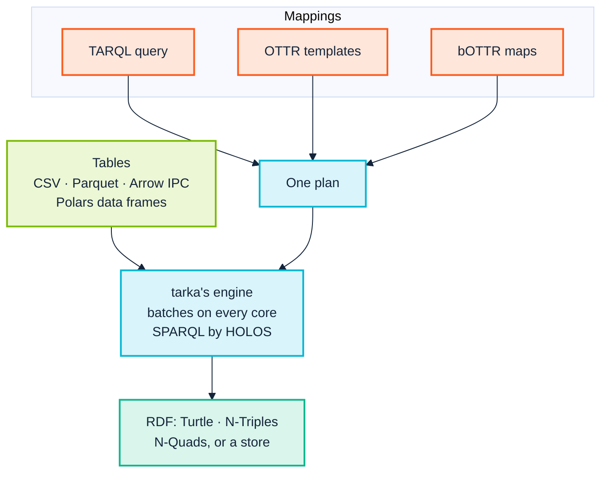

# 1. What tarka does

A great deal of what an organisation knows is in tables: spreadsheets kept by hand, exports
from databases, Parquet files in a lake. A knowledge graph wants the same facts as RDF, in the
terms of an ontology, with every thing named by an IRI and every value typed. tarka is the step
between: it reads the tables and writes the graph.

## One plan, three ways to write it

You tell tarka how a row becomes triples with a **mapping**, and you can write the mapping in
any of three languages:

| Language | What you write | What it is good at |
|---|---|---|
| **TARQL** | a SPARQL `CONSTRUCT` query, run once per row ([TARQL](https://tarql.github.io/), [oxi-gen](https://github.com/semanticarts/oxi-gen)) | computing: building IRIs from text, casting, splitting, reformatting dates. Anyone who knows SPARQL can read it |
| **OTTR** | templates in stOTTR, the Reasonable Ontology Templates language ([ottr.xyz](https://ottr.xyz)) | structure: patterns named once and reused, nested, expanded over lists, checked by a type system before any data is read |
| **bOTTR** | a Turtle file of instance maps, each a query whose rows become instances of a template ([spec](https://spec.ottr.xyz/bOTTR/0.1/)) | OTTR over sources whose cells are not yet terms: language tags, booleans written yes/no, lists in one cell, RDF files read with SPARQL |

The three are not three engines. tarka compiles each mapping to one **plan**, a description of
which triples to make from which cells, and one engine runs every plan. So a mapping behaves
the same and runs at the same speed whichever language it was written in, and Part III of this
manual shows the same bookshops coming out of a TARQL query and out of OTTR templates, triple
for triple.

## Ways in and ways out

**In:** CSV, read in oxi-gen's dialect (a backslash escapes inside quotes); Parquet and Arrow
IPC files, read with Polars, whose typed columns become typed literals and whose list columns
become OTTR lists; and, from Python, any Polars data frame. bOTTR also reads RDF files, with a
SPARQL `SELECT`, and SPARQL endpoints.

**Out:** Turtle, N-Triples or N-Quads, to a file or standard output, optionally gzipped; or
streamed straight into a store with the SPARQL 1.1 Graph Store Protocol, as the triples are
made. From Python, the triples can also come back as a Polars frame of N-Triples terms, to be
inspected before anything is written.

**Around:** tarka writes SHACL shapes describing what a mapping makes, validates its output
against them or any shapes you give it (with [SHACL_Engine](https://github.com/pwin/SHACL_Engine)),
and checks OTTR libraries with a linter that reports what Lutra's does, and more.

## Faithful, then fast

tarka is meant to replace three tools without anyone noticing a difference in the RDF:

- **TARQL** queries give what [TARQL](https://tarql.github.io/) 1.3 (on Jena) gives, including
  Jena's property functions such as `apf:strSplit`, and what
  [oxi-gen](https://github.com/semanticarts/oxi-gen) gives on its test suite.
- **OTTR** templates and **bOTTR** maps give what [Lutra](https://gitlab.com/ottr/lutra/lutra),
  OTTR's reference implementation, gives.

Every release is checked against recorded output from all three, and against the tools
themselves when they are installed. The few differences are deliberate and listed in
[Appendix C](c-differences.md).

Then it is fast, because rows are evaluated in batches on every core. On 200,000 rows of a
retail orders table, tarka 0.3.0 ran the TARQL mapping in 4.8 seconds where TARQL 1.3 took 18.7,
and the bOTTR map in 5.6 seconds where Lutra took 152. The numbers are in
[Chapter 13](13-into-a-store.md).

## What tarka is not

- **Not a store.** It makes RDF; [HOLOS](https://github.com/pwin/triplestore) or any store with
  the Graph Store Protocol keeps it. tarka uses HOLOS's SPARQL engine to evaluate queries, but
  it holds nothing between runs.
- **Not a reasoner.** It writes what the mapping says, not what follows from it. Inference is a
  later stage ([SemOps Manual, Chapter 11](https://www.semantechs.co.uk/SemOps_Manual/11-rules-and-inference.html)).
- **Not RDF 1.2.** tarka reads and writes RDF 1.1 and SPARQL 1.1. A triple term, or a literal
  with a base direction (`"…"@ar--rtl`), is refused with a message rather than half-handled;
  [Chapter 5](05-tarql-in-depth.md) shows where the trail meets that edge.

## Where it sits in a semantic practice

In the [SemOps Manual](https://www.semantechs.co.uk/SemOps_Manual/)'s terms, tarka is the
ingest stage: the step that turns source data into the graph, between modelling the ontology
and validating, reasoning over and publishing what was made. Its
[Chapter 10](https://www.semantechs.co.uk/SemOps_Manual/10-ingest-and-transform.html) walks
that stage end to end, with the Ontology Quality Suite assessing the mapping before any data
moves and the output after. This manual goes deeper into tarka itself, and comes back to the
pipeline in [Chapter 14](14-a-pipeline.md).

---

| [← The tarka Manual](../README.md) | [2. Installing →](02-installing.md) |
|---|---|
