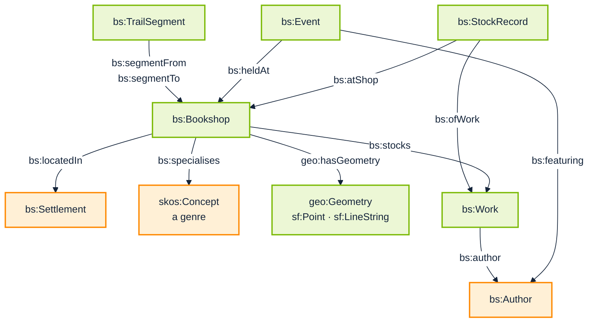

# 3. The Bookshop Trail

The Bookshop Trail is a walking and driving route between independent bookshops, from Portree
on Skye to Penzance at the end of Cornwall, by way of Wigtown, Scotland's book town, and
Hay-on-Wye. Thirty-three shops are on it, in thirty real towns and cities. The shops, their owners, the books and the authors are invented; the
places are real. It is the dataset of the Semantechs
[SPARQL](https://www.semantechs.co.uk/SPARQL_Course/),
[SHACL](https://www.semantechs.co.uk/SHACL_Course/) and
[Ontology](https://www.semantechs.co.uk/Ontology_Course/) courses, and this manual borrows
their data unchanged, so that what you make here can be queried with the SPARQL course's
questions and validated with the SHACL course's shapes.

> **The dataset is fiction.** Any resemblance between a bookshop, publisher, author or book here
> and a real one is coincidental: names were chosen to sound plausible for their setting. See the
> courses' [NOTICE](https://github.com/pwin/SPARQL_Course/blob/main/NOTICE.md).

## The ontology

The trail's vocabulary is a small OWL 2 DL ontology, `reference/01-vocabulary.ttl`, with two
namespaces:

| Prefix | Namespace | Holds |
|---|---|---|
| `bs:` | `https://example.org/bookshop-trail/schema#` | the schema: classes and properties |
| `bt:` | `https://example.org/bookshop-trail/` | the things: `bt:shop-inkwell`, `bt:place-wigtown` … |

It also uses GeoSPARQL (`geo:`, `sf:`) for geometry, WGS84 (`wgs84:`) for coordinates, SKOS
for the genres, and Dublin Core (`dct:`) for titles. The parts this manual fills are these:



Green are the things this manual makes from spreadsheets; orange are reference data, there
already, which the made things point at. A bookshop, as the course data has it:

```turtle
bt:shop-marginalia
    a                       bs:Bookshop, geo:Feature ;
    rdfs:label              "Marginalia"@en ;
    bs:locatedIn            bt:place-wigtown ;
    bs:founded              "1994"^^xsd:gYear ;
    bs:floorArea            "85.0"^^xsd:decimal ;
    bs:staffCount           "2"^^xsd:integer ;
    bs:specialises          bt:genre-poetry ;
    bs:sellsSecondHand      true ;
    bs:hasCafe              false ;
    wgs84:lat               "54.87287"^^xsd:decimal ;
    wgs84:long              "-4.44087"^^xsd:decimal ;
    geo:hasGeometry         bt:geom-shop-marginalia ;
    geo:hasDefaultGeometry  bt:geom-shop-marginalia .

bt:geom-shop-marginalia
    a          sf:Point, geo:Geometry ;
    geo:asWKT  "<http://www.opengis.net/def/crs/OGC/1.3/CRS84> POINT(-4.44087 54.87287)"^^geo:wktLiteral .
```

Every value is typed, every link is an IRI, the name has a language, and the point's
coordinates are written twice: as WGS84 decimals, for anyone, and as GeoSPARQL WKT, for spatial
queries. That is the target. The places, genres and people it points at (`bt:place-wigtown`,
`bt:genre-poetry`) are **reference data**: they are not made from the spreadsheets, but they
must exist for the links to mean anything, and the validation chapters load them beside
tarka's output.

## The committee's spreadsheets

The trail's committee does not keep RDF. It keeps five spreadsheets, the way people keep
spreadsheets, and these are tarka's input, in `data/`:

| File | Rows | One row is |
|---|---|---|
| `bookshops.csv` | 33 | a shop: its name, town, details, coordinates, and the titles it stocks |
| `events.csv` | 59 | a reading, signing, workshop or book club at a shop |
| `works.csv` | 74 | a book: title, author, publisher, year, price, series, translation |
| `stock.csv` | 95 | how many copies of a book a shop has, and at what price |
| `segments.csv` | 33 | a stretch of the trail from one shop to another, with a waypoint between |

The first rows of `bookshops.csv` show the conventions:

```text
shop,name,town,founded,floor_area,staff,specialism,second_hand,cafe,website,lat,long,stocks
bookbarrow,Bookbarrow,keswick,1990,80.0,3,mountaineering,yes,no,https://example.org/shops/bookbarrow,54.60668,-3.13089,scree;the-tarn
bookwyrm,The Bookwyrm,york,2013,120.0,5,fantasy,no,yes,https://example.org/shops/bookwyrm,53.95521,-1.09041,the-dark-sea;the-leat;y-mor-tywyll
```

None of this is RDF, and all of it is reasonable:

- **Short names, not IRIs.** A shop is `bookbarrow`, a town `keswick`, a genre `mountaineering`.
  The mapping turns them into `bt:shop-bookbarrow`, `bt:place-keswick` and
  `bt:genre-mountaineering`.
- **yes and no**, not `true` and `false`.
- **A list in one cell**: the titles a shop stocks, separated by semicolons.
- **Empty cells**: six shops have no website.

`events.csv` writes dates the British way, `06/09/2025`, and prices with a pound sign,
`£28.00`. `works.csv` has columns that are usually empty (series, translations) and gives each
title's language. Each spreadsheet is a chapter's worth of transformation.

Where did they come from? `tools/make-spreadsheets.py` wrote them from the course data, in the
committee's conventions. That makes this manual's best test possible: map the spreadsheets back
to RDF, and the result must be the course's graph, triple for triple. [Chapter 11](11-sparql-checks.md)
shows how that is checked, and it holds for every mapping in the manual.

## Prepared tables

OTTR templates compute nothing (Part III explains why that is a strength). A table for them
holds values as they should come out: `shop:bookbarrow` rather than `bookbarrow`, a WKT literal
rather than two coordinates. `python/prepare.py` makes such tables from the spreadsheets with
Polars, and writes them to `data/prepared/`:

| File | One row is |
|---|---|
| `bookshops.csv` | a shop, with prefixed names, its point as WKT, and its titles as prefixed names |
| `segments.csv` | a segment, joined to the shops at both ends for its label and its line |
| `shop-stock.csv` | a shop's stock as four parallel lists, joined with `;` |
| `shop-stock.parquet` | the same, with real list columns and typed values: integers, and decimals with two places |

[Chapter 9](09-python-and-polars.md) walks through the script. Until then, take the prepared
tables as given.

## A faulty spreadsheet

`data/faulty/bookshops.csv` is `bookshops.csv` with five mistakes of the kind spreadsheets
collect: a town misspelt, a year written "c.1972", a shop with no staff, a website without
`https://`, and a "Yes" where the column says "yes". [Chapter 10](10-shapes-and-shacl.md) finds
every one, and shows which tool finds which.

---

| [← 2. Installing](02-installing.md) | [4. A first mapping →](04-a-first-mapping.md) |
|---|---|
