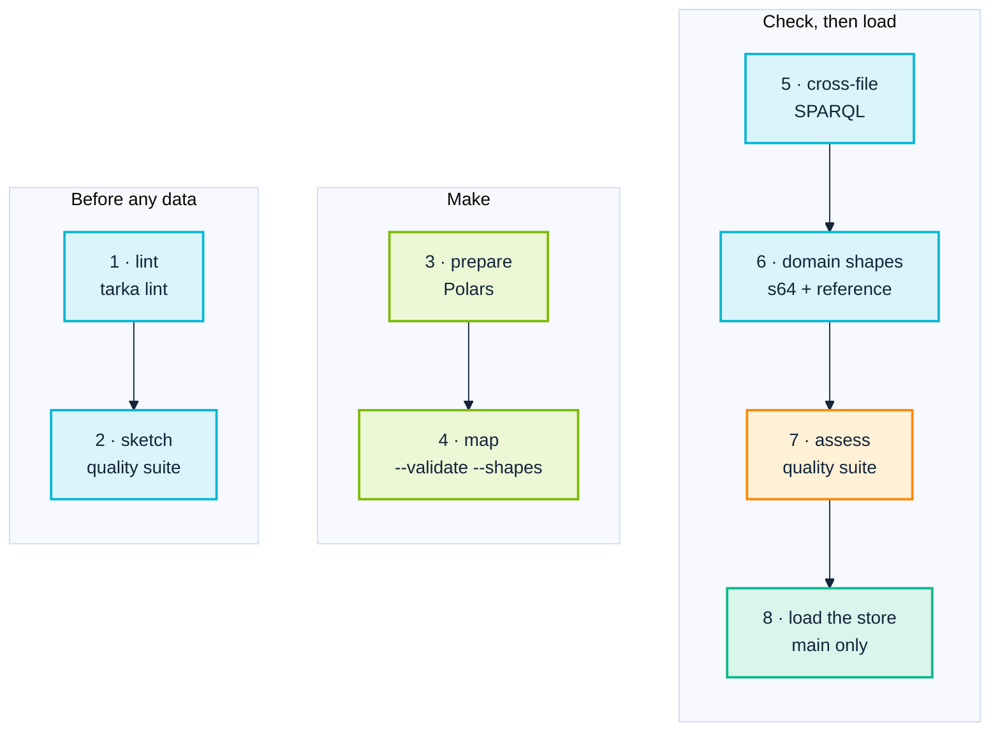

# 14. A pipeline

Every chapter so far has run one step by hand. In production the steps run together, on every
change, and each is a gate: if it fails, the graph does not move on. This chapter puts the trail
into a pipeline, says what each stage protects against, and ends with the properties that make
tarka safe to automate. The stages run in the order of their numbers, left to right:



## The stages

| Stage | Runs | Stops the pipeline when | Protects against |
|---|---|---|---|
| 1. Lint | `tarka lint -l ottr/ --deny-warnings` | a template library has an error or a warning | a template that cannot be right, before it makes anything |
| 2. Sketch | `ontology-quality-suite sketch` | (reported) | a mapping that uses terms the ontology does not declare, or uses them wrongly |
| 3. Prepare | `python python/prepare.py` | the script fails | tables OTTR cannot read |
| 4. Map | `tarka run`, `tarka bottr`, with `--validate` and `--shapes` | a row left out (status 1), output that breaks a shape (status 3) | values that do not fit their mapping, or the project's own rules |
| 5. Cross-file | `tools/sparql.py sparql/cross-file-checks.rq … --expect-none` | any row | files that are each right and disagree |
| 6. Domain shapes | `python/validate.py` (s64, in HOLOS, with the reference data) | any violation | output that is wrong for the trail: unknown towns, impossible values |
| 7. Assess | `ontology-quality-suite data` | (reported) | everything else the suite's registry knows |
| 8. Load | the validated files, into the store | on `main` only | a store holding anything that did not pass |

Stages 2 and 7 report and do not gate, here, because the suite's two false positives
([Chapter 12](12-the-ontology-quality-suite.md)) would stop every run; their reports go with the
run's artefacts, and a reviewer reads them. Gate on them with `--fail-on Violation` once the
findings you accept are scoped out.

## As a workflow

`examples/bookshop-trail/pipeline/trail.yml` is the whole of it as a GitHub Actions workflow.
The heart:

```yaml
      - name: Lint the templates
        run: tarka lint -l ottr/ --deny-warnings

      - name: Prepare the tables
        run: python python/prepare.py

      - name: Map
        run: |
          tarka run -q tarql/bookshops.rq -i data/bookshops.csv --validate --shapes shapes/trail-extra.ttl -o out/bookshops.ttl
          tarka run -q tarql/stocks.rq -i data/bookshops.csv -o out/stocks.ttl
          tarka run -q tarql/events.rq -i data/events.csv --shapes shapes/trail-extra.ttl -o out/events.ttl
          tarka run -q tarql/works.rq -i data/works.csv -o out/works.ttl
          tarka run -q tarql/stock.rq -i data/stock.csv --shapes shapes/trail-extra.ttl -o out/stock.ttl
          tarka bottr -l ottr/ bottr/segments.bottr.ttl -o out/segments.ttl
          tarka bottr -l ottr/ bottr/connections.bottr.ttl -o out/connections.ttl

      - name: Check the set of files
        run: python tools/sparql.py sparql/cross-file-checks.rq out/*.ttl --expect-none

      - name: Validate with the SHACL course's shapes
        run: python python/validate.py out/bookshops.ttl out/stocks.ttl out/stock.ttl out/events.ttl out/works.ttl out/segments.ttl out/connections.ttl
```

and the load, which sends exactly the files that passed, one graph per source, each replaced so
that a reload is idempotent:

```yaml
      - name: Load the store
        if: github.ref == 'refs/heads/main'
        run: |
          for f in bookshops stocks stock events works segments connections; do
            curl -sf -X PUT -H "Content-Type: text/turtle" -H "$AUTH" --data-binary "@out/$f.ttl" \
              "$STORE?graph=https://example.org/bookshop-trail/graph/$f"
          done
```

Where no validation stands between mapping and store, `tarka run … --post $STORE --replace
--graph …` loads as it maps, and saves the file ([Chapter 13](13-into-a-store.md)).

The titles stocked come from the shops' own rows (`bookshops.csv`), and the stock records from
`stock.csv`: two sources, so stage 5's first check, *stocked, but no stock record*, compares two
things that could disagree. Mapping both from one table would make the check pass by
construction, and tell you nothing.

## What makes tarka safe to automate

- **Exit status means something.** 0, complete and conforming; 1, an error or something left out;
  2, a wrong command line; 3, written but not conforming. A pipeline needs no log parsing.
- **A file is all or nothing.** `-o` writes beside the file and moves it into place, so a run that
  fails leaves the last good file, not half of a new one. A load that fails sends the store
  nothing.
- **The same input gives the same bytes.** Output order is the mapping's, blank node labels are
  stable, typed values are canonical (or, through bOTTR, as written, every time). A diff between
  two runs' files is a real change, and the round trip of [Chapter 11](11-sparql-checks.md) works
  between this month's graph and last month's.
- **Errors are messages.** A query tarka cannot evaluate is refused before any row is read; a bad
  row is named, with its column and its value.

## The mappings are code

Treat them so. The queries, templates, maps and shapes live in source control beside the data's
schema; a change to one is a pull request; the pull request runs the pipeline on a sample
(`--test 100`) and the sketch, and the reviewer reads the sketch's findings and the diff of the
output. The manual's own `check.py` is this in miniature: every example, run in order, each
result checked, and if the chapter and the script disagree, the chapter is the bug.

[SemOps Manual, Chapter 9](https://www.semantechs.co.uk/SemOps_Manual/09-continuous-integration.html)
builds continuous integration for a semantic practice around exactly these properties,
[Chapter 10](https://www.semantechs.co.uk/SemOps_Manual/10-ingest-and-transform.html) puts tarka
in its ingest stage, and
[Chapter 12](https://www.semantechs.co.uk/SemOps_Manual/12-release-and-change.html) carries the
graph on through release and change.

## The end of the trail

From five spreadsheets, kept the way people keep spreadsheets, to the courses' graph, triple for
triple, by three routes, every one checked: by shapes as it was written, by the domain's rules
with the data they refer to, by queries across files, by a registry of checks, and against the
graph it was meant to be. That is the whole of tarka, and the whole of the job: making RDF is
the easy part; knowing it is right is the work.

---

| [← 13. Into a store](13-into-a-store.md) | [Appendix A. Command reference →](a-command-reference.md) |
|---|---|
